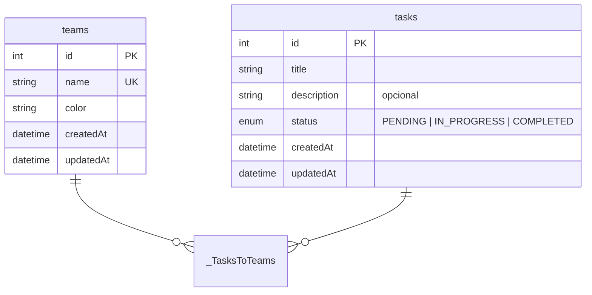

# Desafio HITSS

Monorepo com dois projetos:

- `backend/` — API REST em NestJS + Prisma + PostgreSQL
- `frontend/` — app mobile em React Native com Expo

## 1. Decisões arquiteturais

**Banco: PostgreSQL.** O domínio é relacional de verdade: times e tarefas com uma relação muitos-para-muitos no meio. Um banco relacional resolve isso com uma tabela de junção e integridade garantida pelo próprio banco. Postgres foi a escolha por ser o que eu mais uso, por rodar fácil em Docker e por ter suporte sólido no Prisma.

**ORM: Prisma.** Schema declarativo, migrations versionadas e um client tipado que elimina boa parte dos erros de query em tempo de compilação. O custo é depender do código gerado, que fica em `src/generated` e fora do git.

**Camadas do backend.** Cada módulo (`teams`, `tasks`) segue o mesmo desenho:

- `controller` — só roteamento, parse de parâmetros e documentação Swagger.
- `dto` — validação de entrada com `class-validator`, incluindo normalização (trim) e mensagens em português.
- `service` — regras de negócio: nome único de time, verificação de que os times de uma tarefa existem, erros HTTP semânticos.
- `repositories` — uma interface (`TeamsRepository`) e uma implementação Prisma. O service recebe a interface por injeção, então os testes unitários rodam com um mock e sem banco.

Transversal a tudo, em `src/common`: um interceptor que envelopa toda resposta em `{ data, meta? }`, um filter que converte qualquer exceção em `{ error: { code, message, details? } }`, paginação reutilizável e o logger.

**Logs com Pino.** Estruturados, com `x-request-id` propagado (ou gerado) em toda requisição, o que permite seguir uma chamada do controller ao banco. Em desenvolvimento a saída é legível; em produção vira JSON.

**Frontend.** O app usa Expo com Expo Router (navegação por arquivos) e TypeScript. As decisões sobre camada de dados e estado serão documentadas aqui conforme o app for implementado.

## 2. Modelo de dados



Um time tem um nome único e uma cor. Uma tarefa tem título, descrição opcional e status, e pode pertencer a zero ou mais times. A tabela de junção é implícita do Prisma e some junto quando um lado é apagado: remover um time não remove as tarefas, só o vínculo.

As três migrations em `backend/prisma/migrations` contam a história: a primeira cria o schema, as outras duas renomeiam `team` para `teams`. A terceira foi escrita à mão com `ALTER TABLE ... RENAME` porque o Prisma, sozinho, geraria um drop/create e perderia os dados.

## 3. Como rodar

Pré-requisitos: Docker. Para desenvolver no backend, também Node 24 (o `require(esm)` do Jest 30 precisa de 24.9+) e Yarn.

### Tudo pelo Docker (jeito mais rápido de testar)

```bash
cp .env.example .env
docker compose up --build
```

Isso sobe o Postgres e o backend. O container do backend aplica as migrations, roda o seed (3 times e 7 tarefas) e inicia a API em `http://localhost:3000`. Para mudar a porta, ajuste `BACKEND_PORT` no `.env`. O seed é idempotente, então subir de novo não duplica dados.

A documentação interativa fica em [http://localhost:3000/docs](http://localhost:3000/docs). Para checar que está tudo de pé: `GET /v1/health`.

### Backend em modo de desenvolvimento

```bash
cp .env.example .env
cp backend/.env.example backend/.env

docker compose up -d postgres        # só o banco

cd backend
yarn
yarn prisma:generate                 # gera o client
yarn prisma:migrate                  # aplica as migrations
yarn prisma:seed                     # dados de exemplo
yarn start:dev                       # http://localhost:3000 com reload
```

Testes: `yarn test` (unitários, sem banco). Lint: `yarn lint`. Para zerar o banco e recarregar o seed: `yarn prisma migrate reset`.

### Frontend

```bash
cd frontend
yarn
yarn start      # abre o Expo; i para iOS, a para Android
```

## 4. Exemplos de requisições

Todos os endpoints podem ser testados direto no Swagger, em [http://localhost:3000/docs](http://localhost:3000/docs), com os schemas, exemplos e respostas de erro de cada rota. O documento OpenAPI bruto fica em `/docs/json`, pronto para importar no Insomnia ou Postman.

## 5. O que faria diferente em produção

- **Segurança.** Autenticação (JWT ou sessão), rate limit, `helmet`, CORS restrito aos domínios do app em vez de `*`.
- **Observabilidade.** Os logs já são JSON com request id; faltaria enviá-los a um agregador e adicionar métricas e tracing (OpenTelemetry).
- **Banco.** Pool de conexões dimensionado, índices em `tasks.status` e `tasks.title` conforme as consultas reais, e migrations rodando num passo separado do deploy (`prisma migrate deploy`).
- **Cache.** As listagens são candidatas a cache curto (Redis ou HTTP cache) quando o volume justificar.
- **Escalabilidade.** A API é stateless, então escala horizontalmente atrás de um load balancer; o banco seria gerenciado, com réplica de leitura se necessário.
- **Entrega.** Pipeline de CI com lint, testes e build e variáveis de ambiente vindas de um secret manager.
